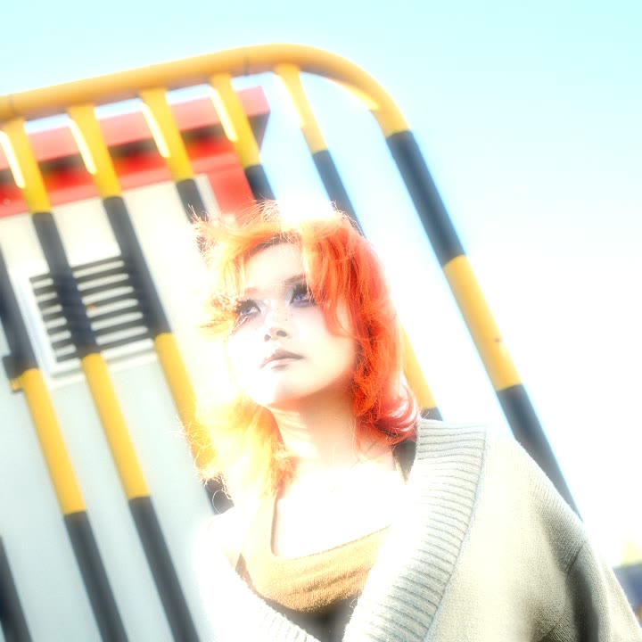
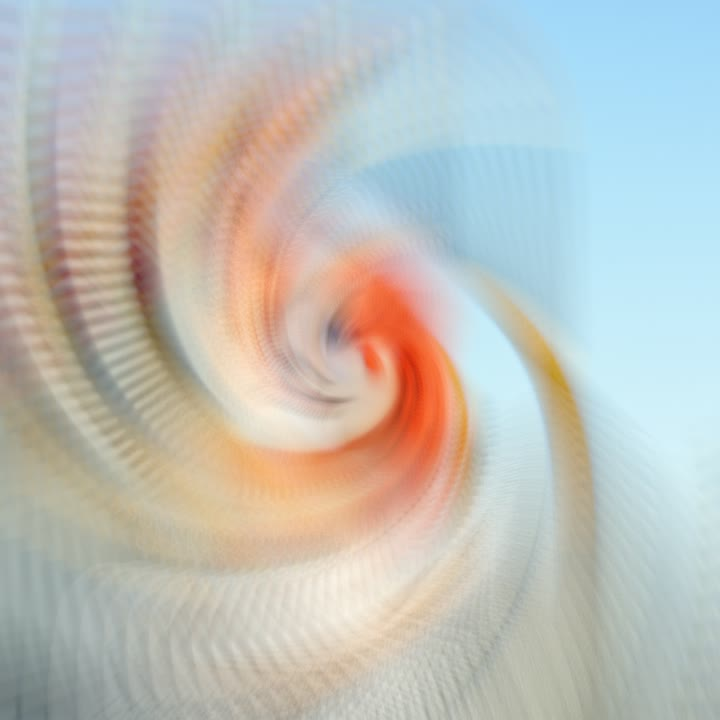

<p align="center">
  
</p>
<h1 align="center">Framecut</h1>
<p align="center"><strong>Open-source video editing that runs on your machine.</strong></p>
<p align="center">
  <a href="#get-started-on-macos">Get started</a> ·
  <a href="#effects">Explore effects</a> ·
  <a href="#performance">See the benchmarks</a> ·
  <a href="#contribute">Contribute</a>
</p>

| Original | Soft Bloom | Tube Monitor | Orbital Blur |
| :---: | :---: | :---: | :---: |
|  |  |  |  |

*Effect samples rendered by Framecut on Metal. Original photograph by [Sou Jest](https://unsplash.com/photos/2v921tlqdXE).*

Framecut is a native editor for turning footage into finished videos. Put clips, titles, and audio on a multitrack timeline, shape a look in the inspector, and animate it with keyframes. Footage stays local. The Rust engine shares its GPU effect pipeline between preview and export.

## What you can make

- **Cut across tracks.** Trim and arrange video, stills, titles, and audio. Use proxies to scrub source footage and adjustment layers to apply a look across several tracks.
- **Shape the picture.** Build a grade with color controls, imported `.cube` LUTs, and stackable effects. Mask or isolate part of a shot, then save the look in the project.
- **Animate the edit.** Keyframe effect parameters, placement, and opacity. Ease between keyframes, retime footage, and place transitions directly on the timeline.
- **Finish and deliver.** Mix audio and export H.264, HEVC, AV1, ProRes 4444, or VP9 with alpha, depending on the encoders available. Compatible Macs can use VideoToolbox for ProRes 4444.
- **Automate repetitive edits.** Use the command-line tool and JSON-RPC API to inspect media, work with projects, render previews, and start exports. [Engine and API guide](src/README.md#driving-concat-without-the-window)

## Get started on macOS

Framecut is currently distributed as source. The macOS launcher has been built and tested on Apple Silicon. Intel Macs use the same launcher, and the Intel build remains unverified.

Install [Homebrew](https://brew.sh/) and the Xcode Command Line Tools. If you need the Command Line Tools, run `xcode-select --install` and let it finish. Then install the build dependencies:

```sh
brew install rustup cmake pkgconf ffmpeg
```

**From a ZIP.** Save the [source ZIP](https://github.com/clankclankclankclank/Framecut/archive/refs/heads/main.zip) as `Framecut-main.zip` in Downloads:

```sh
cd ~/Downloads
unzip Framecut-main.zip
cd Framecut-main
./build_and_run_macos.command --workspace "$PWD"
```

**From Git.**

```sh
git clone https://github.com/clankclankclankclank/Framecut.git
cd Framecut
./build_and_run_macos.sh --workspace "$PWD"
```

The launcher uses the Rust toolchain pinned in the repository and requires FFmpeg 7+ development libraries. During the first build, Slint compilation and linking can spend several minutes near the end of Cargo’s progress counter. Use `--check` to verify the toolchain, or `--build-only` to compile and exit. [Detailed macOS guide](docs/FRAMECUT.md#install-and-run-from-downloads)

## Effects

Add an effect from the library to a selected clip or adjustment layer. Open its inspector controls, set a keyframe, move the playhead, and change the value to animate it. Drop a transition onto the timeline to shape the cut between shots.

| Family | Framecut additions |
| --- | --- |
| Grade and light | **Dusk Grade** separates shadow and highlight tones. **Soft Bloom** spreads bright detail into a controllable glow. |
| Lens and motion | **Prism Fringe** separates color near the edges. **Streak Blur** follows a direction. **Orbital Blur** combines spin and zoom around a movable point. |
| Texture and analog | **Silver Grain** adds time-locked grain. **Screen Print** turns luminance into angled ink dots. **Tube Monitor** adds CRT glass, scanlines, and tape tearing. |
| Impact and cuts | **Spring Hit** adds a damped camera jolt. **Soft Iris** opens a feathered aperture onto the next shot. |

The new effects run through WGSL on a working wgpu backend. Preview and export evaluate the same effect parameters and shaders. Preview resolution, proxies, and encoding can change individual pixels. [Full effect controls](docs/FRAMECUT.md#effects-and-transitions)

## Performance

Measured against Concat commit `22dcbdc` on an Apple M5 Pro with Metal and FFmpeg 9.1.

| Workload | Concat | Framecut |
| --- | ---: | ---: |
| Mean timeline lookup in a 1,802-clip edit | 3.492 µs | **0.515 µs** |
| Median 540p proxy generation | 231 ms | **178 ms** |
| Median 1080p ProRes 4444 export, 120 frames | 8.729 s | **1.233 s** |
| Median 540p H.264 export, 120 frames | 181 ms | 183 ms |

The timeline row measures clip lookup independently from rendering. Warm scrub latency was roughly unchanged in the full rendering test, and cold scrub p95 increased on the sample. The ProRes result compares software encoding upstream with VideoToolbox in Framecut. [Methodology, timings, and reproduction commands](docs/FRAMECUT_BENCHMARKS.md)

## Inside Framecut

| Path | Role |
| --- | --- |
| [`concat`](src/crates/concat/) | Native Slint studio and project workflow |
| [`concat-doc`](src/crates/concat-doc/) and [`concat-core`](src/crates/concat-core/) | Project data, editing operations, exact frame timing, and keyframes |
| [`concat-render`](src/crates/concat-render/) and [`concat-export`](src/crates/concat-export/) | Timeline planning, GPU composition, and rendered output |
| [`concat-media`](src/crates/concat-media/) and [`concat-host`](src/crates/concat-host/) | FFmpeg decode and encode, proxies, preview scheduling, and desktop services |
| [`concat-effects`](src/crates/concat-effects/) | Effect manifests, WGSL packages, and pixel probes |
| [`site/`](site/) | Static site with rendered effect comparisons |

The workspace retains the Concat crate names and document format. [Engine architecture](src/README.md) · [Framecut implementation notes](docs/FRAMECUT.md#implementation-plan-and-files)

## Contribute

Try it on real footage. If a cut, effect, or export behaves unexpectedly, open a [Framecut issue](https://github.com/clankclankclankclank/Framecut/issues/new/choose) with your platform, the source format, and the shortest steps that reproduce it. Effect packages, playback regressions, and build improvements are good starting points for a patch. For setup and checks, see the [contribution guide](CONTRIBUTING.md).

If you use Framecut, a star helps others find the project.

## License and credits

Framecut is an independent project built from [Concat](https://github.com/jub0t/Concat), originally developed by Jareer Abdullah and its contributors. Framecut is open source under **AGPL-3.0-or-later**. [License](LICENSE) · [Third-party notices](THIRD_PARTY_NOTICES.md) · [Upstream trademark policy](TRADEMARK.md)
